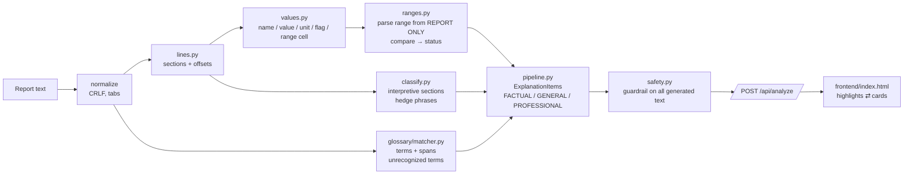

# 🔎 MedLens — Medical Report Explanation & Information Navigator

> **Informational assistance only — not diagnosis or treatment advice.** All data in this repo is **synthetic**.

MedLens takes the text of a medical report (lab panel or radiology report) and:

1. **Finds medical terms** and explains them in plain language: what the test *measures*, never what a value means for *you*.
2. **Highlights values outside the reference ranges printed on the report.** It uses no built-in "normal" ranges at all.
3. **Separates facts from interpretation.** Every explanation is tagged as *Factual (from report)*, *General info*, or *Needs professional interpretation*.
4. **Links every explanation to its exact source text.** Click a highlight to open its card, or click a card to highlight its span in the report.

## Live demo

**https://medlens-68tq.onrender.com**

> **Demo uses synthetic sample data. Do not upload real medical reports.**
>
> Hosted on Render's free tier: the first load after idle takes about a minute (free tier) while the service wakes up.

Deploy your own: push this repo to GitHub, then in Render choose **New → Blueprint** and pick the repo. `render.yaml` defines one free Docker web service (Tesseract OCR included, health check `/api/health`). Public-safety basics:
* 10 MB upload limit.
* 30 requests/minute per IP on `/api/analyze`, `/api/extract` and `/api/verify` (HTTP 429 with a friendly message; `RATE_LIMIT_PER_MIN` to change).
* Report text and uploads are processed in memory and never logged or stored.
* The LLM fallback is off (`USE_LLM=0`, no API key).
* The container runs as a non-root user.

## Quick start

```bash
git clone https://github.com/md0n-cmd/medlens && cd medlens
pip install -r requirements.txt
uvicorn app.main:app --reload        # or: ./run.sh  (creates a venv for you)
```

To open it on your phone (same Wi-Fi), run `./run.sh --lan`. It prints the laptop's LAN URL. Over plain http, the phone uses its native "take a photo" camera button, because browsers only allow a live camera preview on https or localhost.

Open http://localhost:8000. Pick a sample from the dropdown, or open `http://localhost:8000/?sample=01_cbc` directly.

Run the tests with `pytest -v` (494 tests; see [docs/TEST_RESULTS.md](docs/TEST_RESULTS.md)).

## MedLens Verify: check an AI's explanation against your report

People already paste their lab reports into AI chatbots and trust what comes back. The chatbot may quote a textbook "normal range" instead of the one printed on the report, misread a number, call a value normal when the report's own range says otherwise, skip an abnormal result, or slide into a diagnosis or a dose. **MedLens Verify makes that safer by checking the AI against the source.** It is fully deterministic: no LLM is used anywhere.

Paste the report and the AI's text in the **Check an AI explanation** tab (or `POST /api/verify {report_text, ai_text}`). Every sentence of the AI text gets a label, shown as a colour **and** a text badge:

| Label | Meaning |
|---|---|
| ✓ **VERIFIED** | The value, range or high/low/normal claim matches the report. |
| ✗ **CONTRADICTED** | A different number than the report ("AI says 12, report says 11.2"), or the wrong status. |
| ⚠ **RANGE_NOT_FROM_REPORT** | The AI quotes a range the report doesn't print ("AI quotes 12–16; your report prints 13.0 - 17.0"), or the report prints no range at all. |
| ⛔ **OVERSTEPS** | Diagnosis ("you have anemia", "this suggests liver disease"), treatment or dosage ("100 mg twice a day"), or false reassurance ("nothing to worry about"). |
| ? **UNVERIFIABLE** | The report doesn't settle it (ambiguous sex/age range, no range printed, different unit). |
| ∅ **NOT_IN_REPORT** | The AI talks about a test that isn't on the report. |
| *(no label)* NEUTRAL | No checkable claim; shown, not judged. |

Group claims are checked too: "Liver enzymes and proteins are all within normal ranges" is **CONTRADICTED** if any liver test is outside its printed range, and every exception is named. It also lists **omissions**: results outside the printed range that the AI never mentions. A real-world test (a real report plus a real chatbot explanation, replaced in the repo by a synthetic replica for privacy) drove these rules; see [docs/ALGORITHM.md §9.4](docs/ALGORITHM.md#94-real-world-test-findings). A second real-world test, a real chatbot's answer about synthetic sample 01 (committed verbatim as "Real chatbot answer"), went from 3 false contradictions and 1 of 6 interpretations flagged to 0 and 6; see [§9.5](docs/ALGORITHM.md#95-real-world-test-2). For CONTRADICTED, precision beats recall: when unsure, MedLens says UNVERIFIABLE.

**Benchmark:** 0 false alarms on all three sets: 60/60 on 4 real chatbot answers, 63/63 (held-out round 1) and 73/73 (held-out round 2: labs 43/43, imaging 30/30). On first contact the held-out sets scored **26/63 with 18 false alarms** and **38/73 with 21 false alarms** (imaging 10/30). All sets are training data now, so these scores measure fit; round 3 needs fresh answers. History: [§9.6](docs/ALGORITHM.md#96-benchmark-driven-rules), [§9.7](docs/ALGORITHM.md#97-held-out-round-1), [§9.8](docs/ALGORITHM.md#98-held-out-round-2).

*MedLens checks what the AI said against your report. It does not judge medical meaning. Only your doctor can.* Known limits are listed in [docs/ALGORITHM.md](docs/ALGORITHM.md#9-medlens-verify-checking-ai-explanations).

## Glossary

352 static, reviewed entries (no AI), generated by `scripts/build_glossary.py`. The build fails if an alias is shared by two entries. Each entry has a `kind`:
* `test`: what a lab test measures.
* `finding`: a disease or finding word, defined as a **word only** ("A medical term for inflammation of the gallbladder."). Its card always adds: *"This explains the word only. Whether it applies to you is for your doctor to say."* The report line it appears in (e.g. the Impression) stays *Needs professional interpretation*.
* `abbreviation`: CT, USG, ECG, WNL, NAD, B/L, SOL, q.s. … Short ALL-CAPS abbreviations (≤ 4 characters) match in **exact case only**, so `CT` never matches `ct` or `Ct`, and `PT` never matches inside `PTH`.
* `report_word`: anatomy and report vocabulary (anterior, distal, costophrenic angle, within normal limits …).

`python scripts/coverage.py` prints recognized vs unrecognized medical-looking tokens per sample. Across the 9 samples, coverage went from 91% to 99% (143 → 352 entries); see [docs/TEST_RESULTS.md](docs/TEST_RESULTS.md).

## Round 2 features

| Requirement | What MedLens does |
|---|---|
| **Term search** | `GET /api/terms?q=` searches all 352 glossary terms and aliases, ranked exact → prefix → substring → fuzzy (difflib ≥ 0.75, so "hemoglobn" and "bilirubine" work). Max 10 results. UI: live search (200 ms debounce). Results show "✓ in your report (N×)", and ‹ › steps through every occurrence. No match: "Not in our glossary. Ask your clinician or the lab." No definition is ever invented. |
| **Explanations linked to report passages** | Every card carries a `passage` span: the whole source line, or the whole section block for Impression/Remarks/Advice. "Show in report" outlines the passage. Glossary cards for repeated terms show "Appears N times" with ‹ › stepping. A test checks every passage slices the original text and contains its card's span. |
| **Missing-reference-range handling** | Each missing range gets a reason: `no_range_printed`, `placeholder` (`-`, `NA`, `N/A`, `Nil`, `See note`, `Refer table`, `As per clinical context`), `range_unreadable`, `unit_mismatch`, `qualitative_no_reference`, or `other_row_only` (a range printed for another row of the same test is **never borrowed**). Fixed wording: *"Your report does not print a reference range for this test, so MedLens does not compare it. We never use outside 'normal' values. Ask the lab or your doctor what range applies."* Sample: `07_missing_ranges.txt`. |
| **Structured report summary** | `structured_summary` in every `/api/analyze` response, built only from facts already extracted: report header (lab, date, specimen, age, sex; **never the patient name**), sections with tests (value, unit, printed range, status, lab flag, passage span), counts by status, outside-range list with direction, missing-range list with reasons, Impression/Remarks/Advice and hedged lines quoted verbatim, unrecognized terms. UI card with per-section tables, "Download JSON" and "Print summary". |

## Input options

| Tab | How it works |
|---|---|
| **Paste text** | Paste report text and click **Analyze**. |
| **Upload PDF / image** | Drag and drop, or pick a `.pdf`, `.png`, `.jpg`, `.jpeg` or `.webp` file (max 10 MB, type checked by magic bytes). Text PDFs are read from their text layer, with table columns rebuilt from word positions. Scanned pages (under ~20 characters of text) are rendered at 300 DPI and read with OCR. |
| **Scan with camera** | Live preview (`getUserMedia`, rear camera), then **Capture**, **Retake** and **Use this photo**. If camera access is denied or unavailable, it falls back to `<input capture="environment">`, which opens the camera on phones. |

The sample dropdown also has **Sample PDF / image / phone photo / scanned PDF**, so the whole flow can be demoed without a camera. They are generated by `scripts/make_fixtures.py` into `samples/files/`.

**OCR engine (system package):** `sudo apt install tesseract-ocr`. Without it, PDF text extraction still works, image and camera input are disabled in the UI, and `/api/extract` returns 503 for images.

**Why extraction never auto-analyzes.** OCR can misread exactly the characters that matter: `1.1` vs `11`, `O` vs `0`, `l` vs `1`, a dropped decimal point. One wrong digit would produce a wrong "outside range" highlight. So `/api/extract` only fills the text box. A yellow **"Check the text before analyzing"** banner shows the source, the OCR confidence, and the tokens the OCR was unsure about. Below 70% confidence the banner turns orange and asks you to compare every number with the paper report. The user edits the text, then clicks Analyze. (Real example from our scanned-PDF fixture: `HbA1c` was read as `HbAlc` and `< 5.7` as `<25.7`. Both were flagged as uncertain.) Uploads are processed in memory and never written to disk.

## Screenshots

_Placeholder: add `docs/screenshot.png` (annotated report on the left; table and cards on the right)._

## Features

| Area | What it does |
|---|---|
| Range parsing | `70-110`, `70 – 110`, `70 to 110`, `<200`, `≤ 5`, `>40`, `≥ 60`, `Up to 5.0`, `Upto 40`, `Less than 5`, `More than 40`, `(13.0-17.0)`, `[4-11]`, `1,50,000`, `150,000`, `4.5 x10^3/uL`, `10^9/L`, `60 and above`, qualitative (`Negative`), sex-specific (`M: 13-17 F: 12-15`) |
| Comparison | Inclusive vs. exclusive bounds, censored values (`<0.01`, `>1000`), range-valued results (`6-8 /hpf`), unit-mismatch detection, qualitative matching |
| Statuses | `within_range`, `above_range`, `below_range`, `differs_from_reference`, `no_reference_range_supplied`, `ambiguous_range`, `unit_mismatch`, `indeterminate`, `unparseable` |
| Lab-flag validation | Records the lab's own `H`/`L`/`*`/`↑`/`↓` flags and surfaces **"report flag disagrees with computed comparison"** when they conflict |
| Glossary | 352 curated entries (CBC, lipids, LFT, KFT, electrolytes, diabetes, thyroid, urine, serology, radiology wording). Longest match first, alias-aware (SGPT→ALT), word-boundary safe, context-resolved ambiguous abbreviations (PCV) |
| Unknown terms | ALL-CAPS abbreviations and `-itis/-emia/-osis/-iasis/-megaly/-ectomy…` words not in the glossary are listed as *"unrecognized term: ask your clinician"*. MedLens never invents a meaning. |
| Classification | Impression/Conclusion/Advice/Remarks/Note sections, hedged language (*suggestive of*, *cannot be ruled out*, *likely*, *?*, *correlate clinically*…), and combinations of abnormal values are all tagged **Needs professional interpretation** |
| Safety | Every generated sentence passes a guardrail that blocks diagnostic, treatment, dosing, cure and false-reassurance phrasing. Out-of-range values use exactly one fixed template. |
| Friendly UI | "In plain words" summary with links into the cards, "Questions you could ask your doctor" (questions only), text size A / A+ / A++, Print / Save summary |
| Privacy | Report text is processed **in memory only**. It is never written to disk, logged, or sent anywhere (unless you turn on the optional LLM fallback). |

## Architecture



```
app/
  main.py            FastAPI: POST /api/analyze, POST /api/extract, POST /api/verify, GET /api/terms, GET /api/samples, GET /api/health, GET /
  ingest/pdf.py      PDF text layer (layout-preserving) + scanned-page OCR
  ingest/ocr.py      Pillow preprocessing + Tesseract, confidence + uncertain tokens
  models.py          Pydantic schemas (Span, LabValue, TermMatch, ExplanationItem, AnalysisResult…)
  parser/lines.py    line + section segmentation with char offsets
  parser/values.py   result-row extraction (columnar and inline layouts)
  parser/ranges.py   reference-range grammar + interval comparison
  glossary/terms.json  curated dictionary (generated by scripts/build_glossary.py)
  glossary/matcher.py  span matcher + unrecognized-term detector
  classify.py        hedge / interpretive-section rules
  safety.py          guardrail + the only out-of-range wording template
  pipeline.py        orchestration → AnalysisResult
  verify/claims.py   claim extraction from AI-written text (values, ranges, statuses, oversteps)
  verify/check.py    claim checking against the report + omissions
frontend/index.html  single static page, vanilla JS, no build step
samples/*.txt        5 synthetic reports
tests/               pytest suite
```

## API example

```bash
curl -s -X POST localhost:8000/api/analyze -H 'Content-Type: application/json' \
  -d '{"text":"Hemoglobin   11.2   L   g/dL   13.0 - 17.0"}'
```

```jsonc
{
  "values": [{
    "test_name": "Hemoglobin", "value_raw": "11.2", "value_num": 11.2, "unit": "g/dL", "flag_raw": "L",
    "value_span": {"start": 13, "end": 17, "text": "11.2"},
    "reference": {"raw": "13.0 - 17.0", "kind": "interval", "low": 13.0, "high": 17.0, ...},
    "status": "below_range",
    "status_explanation": "This value is below the reference range printed on your report (13–17). What this means for you depends on your overall health and history — discuss it with your doctor.",
    "flag_disagreement": false, "glossary_term_id": "hemoglobin"
  }],
  "terms": [{"term_id": "hemoglobin", "span": {"start": 0, "end": 10, "text": "Hemoglobin"}, "plain_explanation": "A protein inside red blood cells ..."}],
  "explanations": [
    {"tag": "FACTUAL_FROM_REPORT", "title": "Hemoglobin: 11.2", "text": "Report value: 11.2 g/dL. Reference range printed on report: 13–17. Report flag: L. Computed comparison: below range.", "source_snippet": "Hemoglobin   11.2   L   g/dL   13.0 - 17.0", ...},
    {"tag": "NEEDS_PROFESSIONAL_INTERPRETATION", "title": "Hemoglobin: below range", "text": "This value is below the reference range printed on your report (13–17). ...", ...},
    {"tag": "GENERAL_INFO", "title": "Hemoglobin", "origin": "glossary", ...}
  ],
  "summary": {"terms_found": 1, "values_parsed": 1, "out_of_range": 1, ...},
  "disclaimer": "MedLens provides informational assistance only. ..."
}
```

## Safety design

* **No population ranges.** If the report prints no range, the status is `no_reference_range_supplied` and the value is shown neutrally (grey), never flagged.
* **No guessing.** Sex/age-specific ranges are `ambiguous_range` unless the report header states the sex. Mismatched units are never converted. Censored values that overlap a range are `indeterminate`.
* **One template for out-of-range values:** *"This value is above/below the reference range printed on your report (X–Y). What this means for you depends on your overall health and history — discuss it with your doctor."*
* **Guardrail (`app/safety.py`):** regex rules block "you have…", "diagnosis is…", "you should take…", dose and regimen patterns, drug names in recommending contexts, "cure", "treat with", and false reassurance. If any generated text fails, it is replaced by a neutral fallback. Unit tests check that all 352 glossary entries pass.
* **Opinion stays opinion.** Impression/Advice/Remarks lines and hedged sentences are never paraphrased into conclusions. They are labelled *Needs professional interpretation*.
* **Persistent disclaimer** banner in the UI and in every API response.
* **Deterministic and rule-based**, so the same input always gives the same output, and the core cannot hallucinate.

## Limitations

* Plain text only (no OCR or PDF parsing yet). Tables must keep columns separated by 2+ spaces, tabs or `|`, or use the `Name: value unit (range)` form.
* Age- and sex-banded ranges are supported, but only when the header states the age/sex; pregnancy-specific and overlapping bands are always `ambiguous_range`. Footnoted ranges are reported as `unparseable` and not compared.
* The glossary is curated and English-only. Terms outside it are listed, not explained.
* Unit normalisation is cosmetic (`µ`/`u`, `cumm`/`mm3`). There is no numeric unit conversion, by design.
* Detecting the patient's sex relies on a `Sex:` / `Age/Sex:` header in the first 25 lines.

## Round-2 extension points

* **New range formats:** add a regex and branch in `parser/ranges.py::_parse_single`. Comparison is generic over `Interval`s, so no other code changes.
* **New validators** (e.g. derived-value checks such as `Indirect = Total − Direct`, or `A/G = Albumin/Globulin`): add a function in `pipeline.py` alongside `check_flag(v)` that appends notes or explanation items.
* **New glossary terms:** edit `scripts/build_glossary.py`, then run it. Tests enforce schema and safety.
* **New hedge phrases or interpretive sections:** `classify.py::HEDGE_PATTERNS` and `parser/lines.py::INTERPRETIVE_SECTIONS`.
* **New safety rules:** append to `safety.py::BLOCKED_PATTERNS`. They apply to every generated string automatically.
* **Optional LLM fallback (`app/llm.py`):** a `UnknownTermExplainer` hook in `pipeline.analyze()`. It is **off by default**. To turn it on, run `pip install anthropic`, then `USE_LLM=1 ANTHROPIC_API_KEY=... ./run.sh`. Only the unknown term and its one source line are sent (model `claude-opus-5-5`, low effort, server-side refusal fallback). Output is labelled *AI-generated, unverified*, goes through the same safety filter, and any failure falls back to "unrecognized term: ask your clinician".

## Roadmap

* **Multilingual plain-words summary** (Tamil, Hindi first): translate the fixed, reviewed phrase set, not free text, so safety review stays possible.
* **Compare with an earlier report:** match tests across two reports and show "changed since last report" as facts only, with no trend interpretation.
* **FHIR / HL7 import:** read `Observation` resources (value, unit, `referenceRange`) directly, skipping text parsing entirely.
* Higher OCR robustness on real-world photos (perspective correction, table-line removal).

## Docs

* [docs/ALGORITHM.md](docs/ALGORITHM.md): pipeline, range grammar, comparison semantics, classification, provenance
* [docs/EDGE_CASES.md](docs/EDGE_CASES.md): edge case → handling → test
* [docs/TEST_RESULTS.md](docs/TEST_RESULTS.md): latest `pytest -v` output
